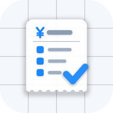
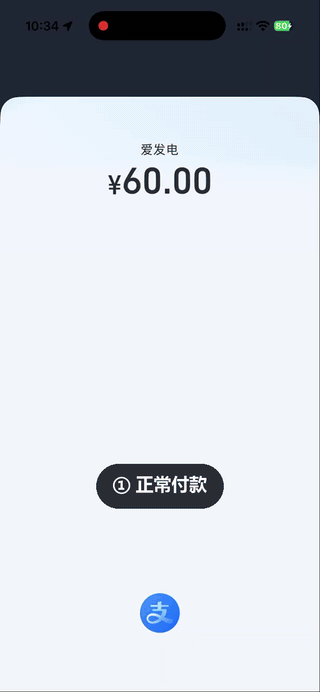
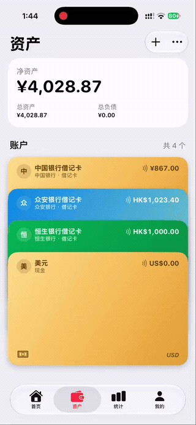
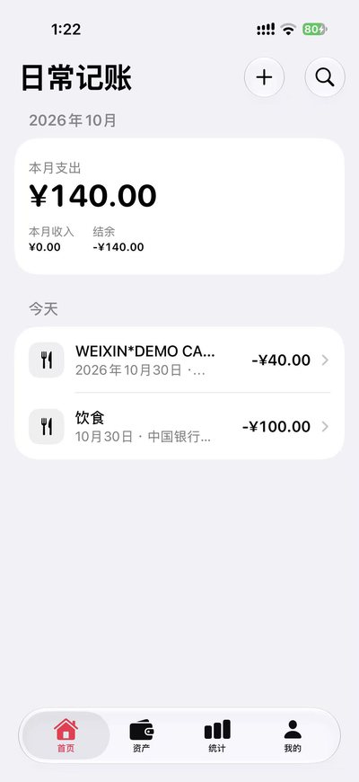
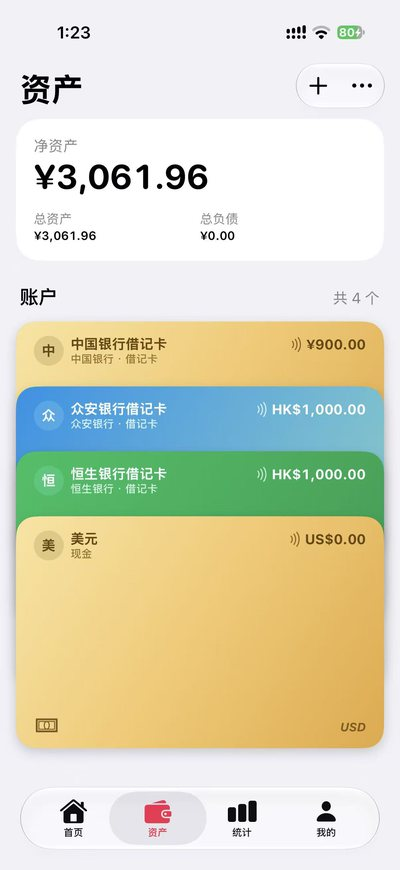
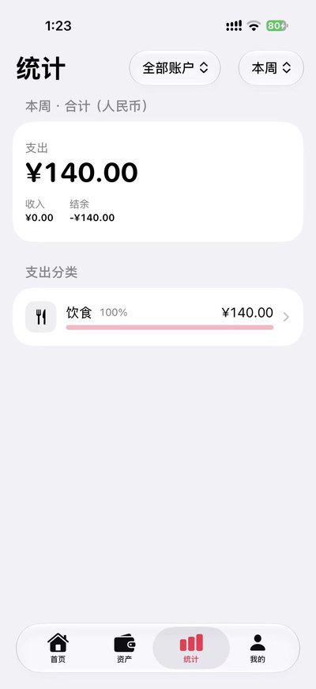
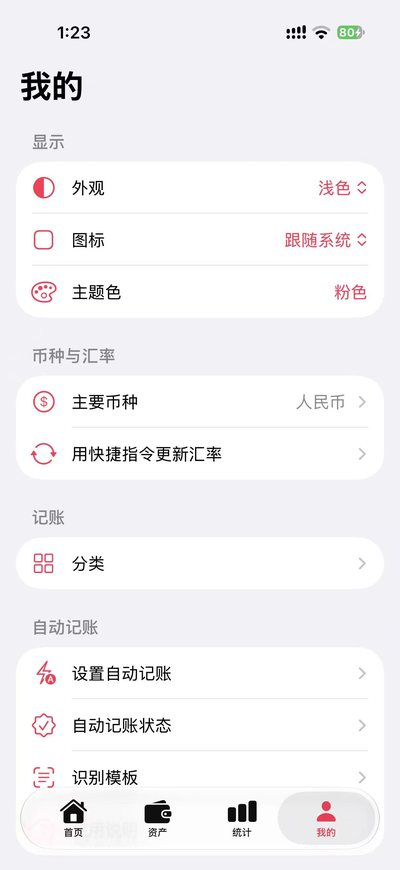

  

<h1 align="center">REC</h1>

<b>Record Every Cent</b> 花了钱，账自动记好。

REC 是一款 iPhone 记账 App。你付完款，银行短信一到，它就在后台把账记好，连 App 都不用打开。

<table>
  <tr>
    <td align="center"></td>
    <td align="center"></td>
  </tr>
  <tr>
    <td align="center">自动记账</td>
    <td align="center">银行卡像钱包一样管理</td>
  </tr>
</table>

## 为什么用它

- **不用手动记账**：设置一次快捷指令，之后银行短信、邮件和 App 通知都能自动入账。
- **账本只在你手机里**：App 不联网，没有服务器，不用注册账号。
- **认不准就先问你**：看不懂的通知放进「待处理」等你确认。同一笔钱收到短信和邮件，也只记一笔。
- **多币种不头疼**：一张卡可以放多个币种，净资产按你的主要币种换算。
- **用起来就像系统自带的 App**：用 SwiftUI 原生开发，界面和手感都跟 iPhone 一致。

  
  
  
  

## 现在能用吗

还在测试，没有上架 App Store。需要 iOS 26 或更高版本，目前要自己签名安装，步骤见[安装指南](docs/guides/ios-swift-windows-sideloadly.md)。

有些银行的短信还认不准，可以在 App 里自己做识别模板。App 里现在还叫「日常记账」，之后会改成 REC。

## 开发

代码在 [`ios-swift/`](ios-swift/README.md)，文档从 [docs/INDEX.md](docs/INDEX.md) 开始看。

## 许可证

[Apache License 2.0](LICENSE)：可以自由使用、修改和商用，分发时需要保留版权声明和 [NOTICE](NOTICE)。许可证不授予使用 REC 名称的权利。
